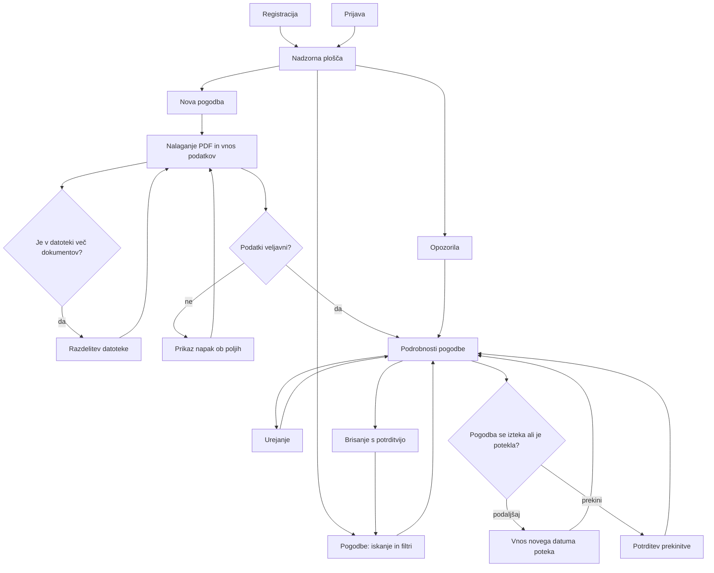

# Uporabniški tok in zasloni

## Glavni tok

Odjava je na voljo na vseh zaslonih po prijavi. Preklop teme (sistemska, svetla, temna; privzeto sistemska) in izbira jezika (slovenščina, angleščina; privzeto slovenščina) sta desno zgoraj na vseh zaslonih, tudi pred prijavo.

## Navigacija

Na računalniku stranska vrstica, na telefonu spodnja vrstica z enakimi postavkami: Nadzorna plošča, Pogodbe, Opozorila. Znak in ime aplikacije sta ena povezava na začetno stran: po prijavi na nadzorno ploščo, pred prijavo na prijavo. Gumb »Nova pogodba« je na voljo na nadzorni plošči in seznamu pogodb.

## Zasloni

| Zaslon | Vsebina | Glavno dejanje | Prazno stanje in napake |
|---|---|---|---|
| Prijava | e-pošta, geslo | Prijava | Napačna e-pošta ali geslo |
| Registracija | ime, e-pošta, geslo | Ustvari račun | Račun s to e-pošto že obstaja; prekratko geslo |
| Nadzorna plošča | število pogodb po statusih, najbližji roki, nazadnje dodane | Nova pogodba | V arhivu še ni pogodb. Dodajte prvo pogodbo. |
| Pogodbe | seznam, iskanje, filtri po kategoriji in statusu | Nova pogodba, Izvozi vse | Nobena pogodba ne ustreza iskanju. Počistite filtre. |
| Nova pogodba in urejanje | nalaganje PDF, obrazec, predogled datoteke ob obrazcu; z dovoljenjem tudi predlogi podatkov z navedkom, stranjo in oznako v predogledu | Shrani pogodbo, Izpolni iz PDF | Napake ob posameznih poljih; napačna vrsta ali velikost datoteke; strežnik umetne inteligence ni dosegljiv; predogleda ni mogoče prikazati |
| Razdelitev datoteke | sličice strani po dokumentih, vrsta in ime vsakega dokumenta; z dovoljenjem predlog razdelitve | Nadaljuj na obrazce, Predlagaj razdelitev | Vsaj en dokument mora biti pogodba; datoteke ni mogoče razdeliti |
| Iskanje po vsebini | ključne besede ali regularni izraz, odlomki z označenimi zadetki in stranjo | Išči | Ni zadetkov; neveljaven izraz; dokumenti, ki še čakajo na obdelavo |
| Podrobnosti pogodbe | podatki, status, predogled in prenos PDF, priloge in aneksi | Podaljšaj, Prekini, Uredi, Izbriši | Datoteke ni mogoče prikazati; pogodba ne obstaja |
| Opozorila | pogodbe, razvrščene po roku za ukrepanje | Odpri pogodbo | Trenutno nobena pogodba ne zahteva ukrepanja. |
| Uporabniki (skrbnik) | seznam računov, vloga, način prijave, število pogodb, stanje | Nov uporabnik | Račun s to e-pošto že obstaja |
| Uporabnik (skrbnik) | ime, vloga, dovoljenja | Shrani, Ponastavi geslo, Blokiraj, Izbriši | Vsaj en dejaven skrbnik mora ostati. |
| E-pošta (skrbnik) | strežnik SMTP, vrste sporočil, ura pošiljanja | Shrani nastavitve, Pošlji preizkus | Povezava s strežnikom ni uspela. |
| Zunanja prijava (skrbnik) | nastavitve OpenID Connect, naslov za preusmeritev | Shrani nastavitve, Preveri povezavo | Povezava s ponudnikom ni uspela. |
| Umetna inteligenca (skrbnik) | ponudnik, naslov, ključ, model, ime podjetja, dnevna omejitev | Shrani nastavitve, Preveri povezavo | Strežnik umetne inteligence ni dosegljiv; ponudnik je zavrnil ključ. |
| Moj račun | opozorila po e-pošti, sprememba gesla; obvezna ob začasnem geslu | Shrani geslo | Sedanje geslo ni pravilno. |

Vsak zaslon ima stanje nalaganja, vsako uspešno dejanje pa kratko potrditveno sporočilo.
